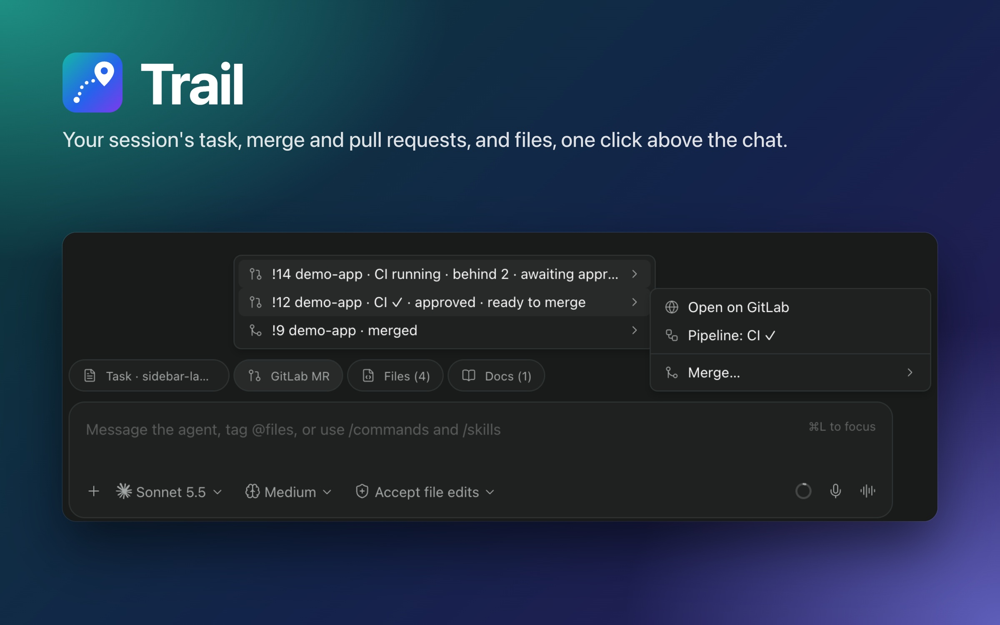

# Trail

A [Paseo](https://paseo.sh) plugin that keeps an agent session's task, merge and pull requests,
and touched files one click away, in buttons above the chat box.



See [OVERVIEW.md](OVERVIEW.md) ([Tiếng Việt](OVERVIEW.vi.md), [简体中文](OVERVIEW.zh-CN.md)) for what it shows, setup and data access.

## Install

```bash
paseo plugin install github:ttquoccuong/paseo-trail
```

Trail works without configuration. For task docs or a self-hosted GitLab, add
`.paseo/trail/config.json` to a project, or `$PASEO_HOME/trail/config.json` for a personal setup.
Settings, Plugins, Trail shows what it found and takes tokens.

## Files

| Path | Scope | Contents |
|---|---|---|
| `<project>/.paseo/trail/config.json` | Project, can be committed | Task docs, forge hosts, project catalog; paths stay inside the project, no token files, no task ID pattern |
| `$PASEO_HOME/trail/config.json` | Personal | Same format, used when no project file is found or the project's is refused; the only place `tokenFiles`, `tokenKey` and `focus.taskId` are read from, and the hosts glab is asked about |
| `$PASEO_HOME/trail/state/` | Personal | Links collected per session, chosen display mode |
| `$PASEO_HOME/trail/secrets/` | Personal, mode 0700 | Tokens pasted in Settings, mode 0600 |

`$PASEO_HOME` is `~/.paseo` unless the daemon is started with another home.

## Configuration

Trail looks for `.paseo/trail/config.json` by walking up from the agent's working directory and
falls back to the personal file, both when there is no project file and when the nearest one is
refused (Settings, Plugins, Trail says why). Relative paths resolve against the directory holding `.paseo` in a
project file and against the agent's working directory in the personal file; `~/` is the daemon
user's home.

```json
{
  "focus": {
    "root": "docs",
    "taskDocs": ["tasks/*/README.md", "tasks/*.md"],
    "remoteUrl": "https://gitlab.example.com/team/docs/-/blob/main/{path}",
    "relatedSection": "Related",
    "bundle": "siblings",
    "taskId": { "pattern": "\\b([A-Z]+-\\d+)\\b", "url": "https://tracker.example.com/browse/{id}" }
  },
  "gitlab": [
    {
      "host": "gitlab.example.com",
      "projects": { "api": "team/backend/api" },
      "projectCatalog": { "file": "catalog.json", "items": "repositories", "name": "name", "project": "path" }
    }
  ]
}
```

| Field | Meaning |
|---|---|
| `focus.root` | Folder the task docs live in |
| `focus.taskDocs` | Up to 32 globs for task docs, each at most 256 characters and 16 segments: `*` and `?` match within one path segment, `**` spans folders (at most two per glob, repeats folded into one), the last segment names a file rather than `**`, and a match covers a whole path (`tasks/*.md` does not match `oldtasks/a.md` or `tasks/a.md.bak`) |
| `focus.remoteUrl` | Forge page for a doc, `{path}` replaced by its path; without it a task has only the local view |
| `focus.relatedSection` | Heading whose merge requests belong to the task; without it the whole doc counts |
| `focus.bundle` | `"siblings"` adds the other Markdown files of a `<name>/README.md` task: up to 20, from its folder and one level of subfolders, reading at most 200 directory entries. Only the session's main task lists them; other pinned tasks open as a single file |
| `focus.taskId` | Personal file only: a regular expression reading a task ID from the agent's git branch or title when the session has no task doc; it applies in every project, including one whose file has no `focus` block or was refused |
| `gitlab[]` | Up to 16 entries, one per GitLab host (a host listed twice is refused); the host is a plain name with an optional port |
| `gitlab[].projects`, `gitlab[].projectCatalog` | Let `name !N` references resolve to a project: the name declared for it (a `projects` key, a catalog `name`) first, then its full path or last path segment. Up to 500 `projects` per host and the first 2,000 entries of a catalog; across all entries at most 5,000 distinct ones are kept |
| `gitlab[].tokenFiles`, `gitlab[].tokenKey` | Personal file only: up to 8 `KEY=value` files to read the host's token from, and the key (letters, digits, underscores) |

A project file comes with the project, so its `focus.root` and `projectCatalog.file` must stay
inside the project, and it cannot set `tokenFiles`, `tokenKey` or `focus.taskId`, whose pattern runs
on every poll. Trail ignores a project file that breaks these rules and shows why in Settings,
Plugins, Trail, then uses the personal file. Files a project names, the config itself included, are read only when they resolve
inside the project after following symlinks, are regular files, and stay small: 256 KB for the
config, 1 MB for a catalog, 512 KB for a task doc. In the personal file, relative `tokenFiles`
resolve against its own folder:

```json
{
  "gitlab": [{ "host": "gitlab.example.com", "tokenFiles": ["~/.config/gitlab/token.env"] }]
}
```

### How references are matched

Merge and pull requests count when written as a URL, as `group/project!N` or `name !N` for GitLab,
or as `owner/repo#N` for GitHub. A reference without a URL needs a host and a project:

- `group/project!N` uses, in order: the host of an MR the session already links in that project,
  the host of the one catalog or `projects` entry with that exact path (with several GitLab hosts
  too), or the config's GitLab host when it lists exactly one. Otherwise it is left out.
- `name !N` resolves only when the project is certain: a project the session already links, a name
  listed once in `projects` or the catalog, or the catalog entry in the group most of the session's
  requests come from.
- Ambiguous references and a bare `!N` or `#N` are left out.

The bar lists the first 20 MRs the task doc links by URL (references without a URL in the doc are
not read), every MR or PR pinned, and the five other ones the session mentioned most recently; in
all-links mode each group of files, documents and other links keeps its 15 most recent entries.
Each scan reads the newest 300 messages, up to 2 MB of text and at most 64 KB of each; during a
turn a session is scanned every 30 seconds for at most 3 hours.

### Limits on requests and hosts

- Status requests to all forges share four slots, and token checks have two of their own. Each
  request, including its wait for a free slot, times out after 15 seconds; a token check that timed
  out waiting is tried again after 30 seconds instead of ten minutes.
- A request answered with 403, 404 or 410 is not asked for again for 30 minutes; after any other
  failure, for one minute. Each failure is logged once until its reason changes.
- GitLab hosts you have not set up (not in the personal config, no pasted token, and not the
  `GITLAB_HOST` host, which is gitlab.com when that variable is unset) are tracked in two pools of
  ten: hosts named by a project file, and hosts seen only in conversations. A tracked host stays
  until neither pool has seen it for a day. Past the limit a host is listed in Settings as one too
  many and never contacted.

A task doc becomes the session's task when the user names it or the agent edits it; one that was
only read does not.

## Environment variables

Read from the Paseo daemon's environment, which is fixed when the daemon starts: restart the daemon
after changing one.

| Variable | Used for |
|---|---|
| `GITLAB_TOKEN` | GitLab token for the host named by `GITLAB_HOST` |
| `GITLAB_HOST` | Which GitLab host `GITLAB_TOKEN` belongs to, as a host or URL; `gitlab.com` when unset |
| `GITHUB_TOKEN`, `GH_TOKEN` | github.com token, in that order |
| `PASEO_HOME` | Where Trail keeps personal files (set by Paseo) |

For a GitLab host the order is: a token pasted in Settings, the personal config's `tokenFiles` for
that host, `GITLAB_TOKEN` when `GITLAB_HOST` names the host, then `glab`. For github.com: a pasted
token, `GITHUB_TOKEN`, `GH_TOKEN`, then `gh`. `glab` is only asked about GitLab hosts listed in the
personal config, because it answers for any host with a token stored at the top of its config; `gh`
is only asked about github.com. Both run with the token variables above removed from their
environment. GitLab tokens are sent as `Authorization: Bearer`, which GitLab accepts for personal,
project, group and OAuth tokens; a token without an access-token record (OAuth, from a browser
`glab auth login`) is checked on `/api/v4/user` instead, without scope or expiry details. GitLab
OAuth tokens expire after about two hours and glab renews them only when glab itself runs, so in
between Trail reports such a token as rejected; a personal access token avoids that. Trail sets `TRAIL_STATE_DIR` for its own MCP server, and Paseo sets `PASEO_AGENT_ID`
for each agent; neither needs to be set by hand.

## Develop

```bash
yarn install
yarn typecheck
yarn test
paseo plugin install "$PWD"      # then `paseo plugin reload trail` after each change
```

The plugin is plain TypeScript compiled by Paseo; there is no build step.
