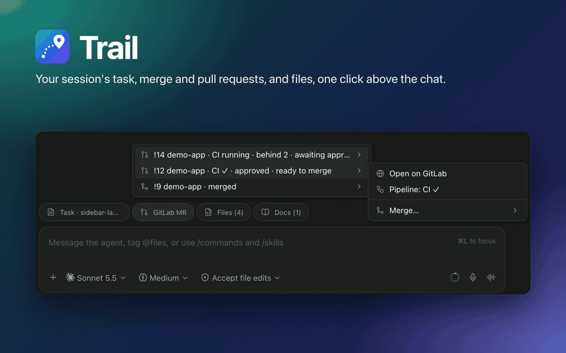

# Trail

A long agent session scatters its work through the chat: the task it started from, the merge requests
it opened, the files it changed. To check whether CI passed you scroll back, find the link and open a
new tab.

Trail is a [Paseo](https://paseo.sh) plugin that keeps all of it in buttons above the chat box, with
live status for each request. It works with GitHub and with GitLab, self-hosted included.



## Install

```bash
paseo plugin add ttquoccuong/trail
```

This installs the version reviewed for [Paseo's plugin directory](https://paseo.sh/plugins/ttquoccuong/trail).
Trail needs Paseo 0.13 or later, with the daemon on macOS or Linux; Windows is not tested. Links work
without setup. Status and actions need a token, which Settings, Plugins, Trail helps you add.

## What you get

- **Task.** The doc or issue the session works on, opened beside the chat or on your Git forge.
- **Merge and pull requests.** State, CI, conflicts, commits behind and approval, refreshed about once
  a minute. Rebase, Update branch and Merge are one confirmation away.
- **Files, docs and other links.** The most recent ones the session touched, including pages on tools
  such as Figma, Notion or Google Docs.
- **Self-hosted GitLab.** Point Trail at your host and project catalog, so that a reference like
  `api !42` resolves to the right merge request.

[OVERVIEW.md](OVERVIEW.md) has the full tour ([Tiếng Việt](OVERVIEW.vi.md), [简体中文](OVERVIEW.zh-CN.md)).

## What it reads and changes

Plugins run unsandboxed on the daemon machine, so here is what Trail touches:

- **Reads** the session's newest 300 messages, the task folder and files the agent touched (up to
  512 KB each), the branch name through `git rev-parse`, Paseo's `config.json` and the manifests of the
  plugins listed there. It can ask `glab` and `gh` for a token.
- **Keeps** its own files under `$PASEO_HOME/trail`: personal config, collected links, per-session
  choices and pasted tokens (mode 0600). Its two settings live in Paseo's settings, and each command
  leaves a note in the agent's timeline.
- **Adds** a `trail` MCP server with a `pin_link` tool to new Claude and Codex agents, plus a short
  instruction that is sent to the model provider with the rest of the conversation.
- **Sends** a token only to the host it was set up for, and never along a redirect. A GitLab host named
  only by a link or a project file is not contacted until you set it up. `GITLAB_TOKEN` is the one
  exception: it goes to the host `GITLAB_HOST` names, or gitlab.com when that is unset.
- **Changes your forge** only when you confirm Rebase, Update branch or Merge. Merge is refused if the
  branch or the merge settings changed since the status was read.

## Limits

GitHub support covers github.com only. Agents created before Trail was installed have no `pin_link`
tool, and a forked session starts with an empty bar until its agent pins the task. A bare `!N` or `#N`
is not linked.

## Configuration

For task docs or a self-hosted GitLab, add `.paseo/trail/config.json` to a project, or
`$PASEO_HOME/trail/config.json` for a personal setup. Settings, Plugins, Trail shows what it found and
takes tokens.

[docs/configuration.md](docs/configuration.md) lists every field, how references are matched, request
limits and the order tokens are looked up in.

## Develop

```bash
yarn install
yarn typecheck
yarn test
paseo plugin install "$PWD"      # then `paseo plugin reload trail` after each change
```

The plugin is plain TypeScript compiled by Paseo; there is no build step.
